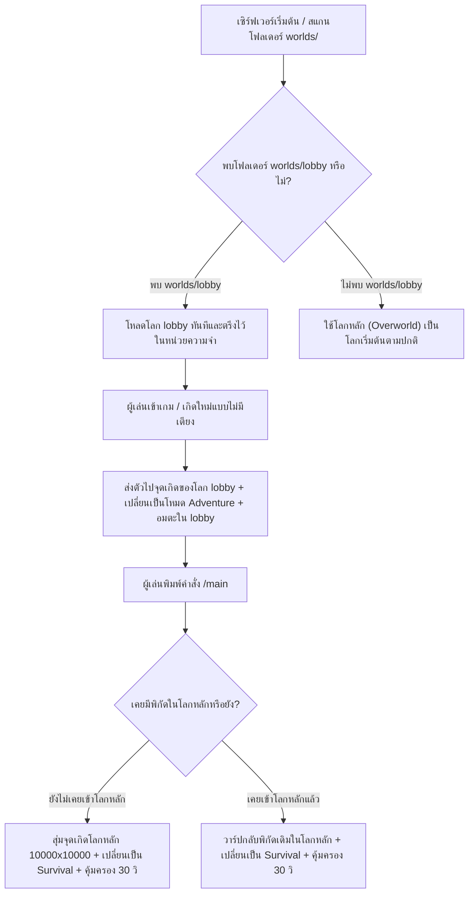

# แผนการพัฒนา: ระบบโลก Lobby อัตโนมัติ, การแยก Datapack รายโลก และการจัดระเบียบคำสั่งโลก

เอกสารฉบับนี้สรุปแผนการปรับปรุงระบบจัดการโลก (`WorldManager`), ระบบเขตที่ดิน (`Protection` / `ClaimCommands`), ระบบโลก `lobby` อัตโนมัติ และการรองรับ `datapacks` แยกตามแต่ละโลก

---

## 1. การจัดระเบียบคำสั่ง `/worlds` และนำ `/spawn` ออก

### 1.1 ยกเลิกคำสั่ง `/spawn`
- ลบการลงทะเบียนคำสั่ง `/spawn` ออกจาก [WorldManager.java](file:///home/dritestudio/.gemini/antigravity-cli/scratch/Mod/src/main/java/studio/timeandtime/claimmap/world/WorldManager.java) และนำออกจากรายการคำสั่งที่อนุญาตใน [CommandFilter.java](file:///home/dritestudio/.gemini/antigravity-cli/scratch/Mod/src/main/java/studio/timeandtime/claimmap/CommandFilter.java)
- ผู้เล่นใช้คำสั่ง `/main` เพียงคำสั่งเดียวสำหรับเดินทางกลับสู่โลกหลัก
- อัปเดตคำอธิบายในหน้าต่าง `/help` ([HelpGui.java](file:///home/dritestudio/.gemini/antigravity-cli/scratch/Mod/src/main/java/studio/timeandtime/claimmap/HelpGui.java)) และเอกสารคู่มือคำสั่ง

### 1.2 ปรับปรุงคำสั่ง `/worlds` (สำหรับแอดมิน)
- นำคำสั่งย่อย `/worlds create`, `/worlds load`, `/worlds unload` และ `/worlds tp` ออกทั้งหมด เนื่องจากระบบจัดการโหลด/ปิดโลกอัตโนมัติอยู่แล้ว และไม่ต้องการให้สร้างโลกผ่านคำสั่ง
- คำสั่ง `/worlds` จะเหลือเฉพาะคำสั่งตรวจสอบและสแกน:
  | คำสั่ง | การทำงาน |
  | :--- | :--- |
  | `/worlds list` | แสดงรายชื่อโลกทั้งหมดในโฟลเดอร์ `worlds/` สถานะการโหลด และจำนวนผู้เล่นในแต่ละโลก |
  | `/worlds scan` | สั่งสแกนโฟลเดอร์ `worlds/` ทันทีเพื่อตรวจจับโลกหรือการเปลี่ยนแปลงใหม่ |
- การเดินทางไปยังโลกต่างๆ ให้พิมพ์ `/<ชื่อโลก>` โดยตรง (เช่น `/lobby`, `/resource`, `/creative`)

---

## 2. จำกัดระบบเขตที่ดิน (Claim System) ให้ทำงานเฉพาะโลกหลัก

- **การป้องกันบล็อกและพื้นที่ ([Protection.java](file:///home/dritestudio/.gemini/antigravity-cli/scratch/Mod/src/main/java/studio/timeandtime/claimmap/Protection.java)):**
  - ตรวจสอบ `level == level.getServer().overworld()` ก่อนเช็คสิทธิ์เขตที่ดินเสมอ
  - หากผู้เล่นอยู่ในโลกอื่นที่ไม่ใช่โลกหลัก (`Overworld`) ระบบเขตจะไม่บล็อกการทุบ การวาง หรือการโต้ตอบกับบล็อก (ยกเว้นโลก `lobby` ที่ควบคุมด้วยโหมด Adventure)
- **การระเบิดของครีปเปอร์ ([ServerExplosionMixin.java](file:///home/dritestudio/.gemini/antigravity-cli/scratch/Mod/src/main/java/studio/timeandtime/claimmap/mixin/ServerExplosionMixin.java)):**
  - ป้องกันบล็อกพังจากครีปเปอร์เฉพาะในเขตที่ดินของโลกหลัก (`Overworld`) เท่านั้น ส่วนในโลกอื่นทำงานตามปกติ
- **คำสั่งเขตที่ดินและเรดาร์ ([ClaimCommands.java](file:///home/dritestudio/.gemini/antigravity-cli/scratch/Mod/src/main/java/studio/timeandtime/claimmap/ClaimCommands.java), [ClaimMapGui.java](file:///home/dritestudio/.gemini/antigravity-cli/scratch/Mod/src/main/java/studio/timeandtime/claimmap/ClaimMapGui.java)):**
  - บล็อกการใช้คำสั่ง `/claim`, `/claim add`, `/claim remove`, `/claim tf`, `/claim at` และ `/map` เมื่อผู้เล่นไม่ได้อยู่ในโลกหลัก พร้อมแสดงข้อความแจ้งเตือน
  - คำสั่ง `/claim tp <cellId>` ยังคงใช้ได้จากทุกโลก เพื่อวาร์ปตัวผู้เล่นกลับมาที่เขตที่ดินในโลกหลักได้โดยตรง

---

## 3. ระบบตรวจสอบและโหลดโลก `lobby` อัตโนมัติ (Adventure Mode)

### รายละเอียดการทำงานของระบบ Lobby:
1. **การตรวจจับอัตโนมัติ (`hasLobbyWorld`):**
   - เมื่อ `WorldManager` เริ่มทำงานหรือสแกนโฟลเดอร์ `worlds/` หากพบโฟลเดอร์ชื่อ `lobby` ที่เป็นเซฟโลกที่ถูกต้อง ระบบจะสั่ง `loadLocked` โลก `lobby` ทันที และยกเว้นไม่ให้โลก `lobby` ถูก Auto-Unload เมื่อว่างเปล่า
2. **การส่งผู้เล่นเข้าโลก `lobby`:**
   - **เมื่อมีโลก `lobby`:**
     - ผู้เล่นที่เพิ่งเข้ามาใหม่ หรือผู้เล่นที่เข้าเซิร์ฟเวอร์ขณะอยู่ในโลก `lobby` หรือตายโดยไม่มีเตียงในโลกหลัก จะถูกส่งไปยังจุดเกิด (`Spawn Point`) ของโลก `lobby` (ไม่ใช้การสุ่มพิกัด 2,500 หรือ 10,000 บล็อกในโลก `lobby`)
     - เมื่อผู้เล่นเข้าสู่โลก `lobby` (ไม่ว่าจะเข้าเกมใหม่ หรือพิมพ์ `/lobby`) ระบบจะเปลี่ยนโหมดการเล่นเป็น **Adventure Mode (`GameType.ADVENTURE`)** อัตโนมัติ (สำหรับผู้เล่นทั่วไปที่ไม่ใช่แอดมินโหมด Creative/Spectator) และป้องกันความเสียหายทั้งหมดขณะอยู่ใน `lobby`
   - **เมื่อไม่มีโลก `lobby`:**
     - ระบบจะข้ามขั้นตอน `lobby` และส่งผู้เล่นเข้าสู่โลกหลัก (`Overworld`) ทันทีเหมือนเดิมทุกประการ
3. **การเดินทางจาก `lobby` ไปยังโลกหลักด้วย `/main`:**
   - เมื่อผู้เล่นพิมพ์ `/main` (หลังจากนับถอยหลัง 5 วินาที):
     - ระบบจะตรวจสอบว่าผู้เล่นเคยมีพิกัดบันทึกไว้ในโลกหลัก (`mainWorldPositions` / `spawnedPlayers`) หรือไม่
     - หากยังไม่เคยเข้าโลกหลักมาก่อน ระบบจะสุ่มจุดเกิดปลอดภัยในระยะ `10,000 x 10,000` บล็อกของโลกหลัก และบันทึกพิกัดไว้
     - หากเคยเข้าโลกหลักมาแล้ว ระบบจะวาร์ปกลับไปยังพิกัดล่าสุดในโลกหลัก
     - เปลี่ยนโหมดการเล่นของผู้เล่นกลับเป็น **Survival Mode (`GameType.SURVIVAL`)** อัตโนมัติ และมอบบัฟคุ้มครองความปลอดภัย 30 วินาที

---

## 4. ระบบแยก Datapack ประจำแต่ละโลก (`worlds/<ชื่อโลก>/datapacks`)

เพื่อให้แต่ละโลกภายใต้ `worlds/<ชื่อโลก>/` สามารถใส่ Datapack แยกกันได้โดยอิสระ (เช่น โลก `lobby` มี Datapack เฉพาะตัว, โลก `resource` มี Datapack โครงสร้างดันเจี้ยนเฉพาะตัว) ระบบจะดำเนินการดังนี้:

### 4.1 โครงสร้างโฟลเดอร์
- เมื่อโหลดหรือสแกนโลกใน `worlds/<ชื่อโลก>/` ระบบจะสร้างโฟลเดอร์ `worlds/<ชื่อโลก>/datapacks/` ให้อัตโนมัติหากยังไม่มี
- ผู้ดูแลสามารถนำไฟล์ Datapack (`.zip` หรือโฟลเดอร์ที่มี `pack.mcmeta`) ไปวางใน `worlds/<ชื่อโลก>/datapacks/` ของโลกนั้นๆ ได้โดยตรง

### 4.2 การโหลด Worldgen & Dimension Datapack แยกตามโลก
- ในขั้นตอน `WorldManager.loadLocked(WorldDefinition def)`:
  - สร้าง `PackRepository` เฉพาะของโลกนั้นโดยอ่านจาก `worlds/<ชื่อโลก>/datapacks/` ร่วมกับ Vanilla Pack
  - โหลด `WorldLoader` / `RegistryAccess` เฉพาะสำหรับโลกนั้นเพื่อดึงค่า `LevelStem`, `ChunkGenerator`, `Biome`, `Structure` และ `NoiseGeneratorSettings` ที่กำหนดใน Datapack ของโลกนั้นมาสร้าง `ServerLevel`
  - ผลลัพธ์คือ Datapack ประเภทปรับแต่งการสร้างโลก (World Generation, Custom Structures, Custom Biomes) ที่ใส่ไว้ใน `worlds/<ชื่อโลก>/datapacks/` จะมีผลเฉพาะการสร้างพื้นที่ในโลกนั้นเท่านั้น ไม่ปะปนกับโลกหลักหรือโลกอื่น

### 4.3 การโหลด Function / Loot Table / Tag แยกตามบริบทของโลก
- สร้างตัวจัดการ `WorldDatapackManager` เพื่อเชื่อมต่อ `FolderRepositorySource` จาก `worlds/<ชื่อโลก>/datapacks/`:
  - สำหรับ Datapack ที่มีฟังก์ชัน (`data/<namespace>/function/*.mcfunction`) ระบบจะผูกการรันฟังก์ชันประจำโลก (เช่น `tick` หรือ `load`) ให้รันภายใต้ `CommandSourceStack` ที่ระบุ `ServerLevel` เป็นโลก `worlds/<ชื่อโลก>` นั้นๆ โดยตรง (`source.withLevel(worldLevel)`)
  - คำสั่งภายในฟังก์ชันของ Datapack ประจำโลก (เช่น `@a`, `execute`, `setblock`, `summon`) จะทำงานเฉพาะกับผู้เล่นและพิกัดภายในโลกนั้นเท่านั้น ไม่กระทบผู้เล่นในโลกอื่น

---

## 5. รายการไฟล์ที่จะทำการแก้ไขและเพิ่มเติม

1. [WorldManager.java](file:///home/dritestudio/.gemini/antigravity-cli/scratch/Mod/src/main/java/studio/timeandtime/claimmap/world/WorldManager.java)
   - ลบคำสั่ง `/spawn` และลบคำสั่งย่อย `/worlds create`, `/worlds load`, `/worlds unload`, `/worlds tp`
   - เพิ่มการตรวจจับและโหลดโลก `lobby` อัตโนมัติ (`hasLobby()`, `lobbyLevel()`, `teleportToLobby()`)
   - แยกพฤติกรรมการวาร์ปเข้าโลก `lobby` (ไปจุดเกิดคงที่ + โหมด Adventure) ออกจากโลกทั่วไป (สุ่มพิกัด + โหมด Survival)
   - ปรับการวาร์ป `/main` ให้รองรับการสุ่มเกิดครั้งแรกเมื่อย้ายมาจาก `lobby` และเปลี่ยนโหมดกลับเป็น Survival
   - เชื่อมต่อการโหลด Datapack จาก `worlds/<ชื่อโลก>/datapacks/` ขณะเมานต์โลก
2. `WorldDatapackManager.java` (ไฟล์ใหม่ในแพ็กเกจ `studio.timeandtime.claimmap.world`)
   - จัดการสแกนและโหลด Datapack จาก `worlds/<ชื่อโลก>/datapacks/` ทั้งส่วน Worldgen LevelStem และส่วนการรัน Function ประจำแต่ละ `ServerLevel`
3. [WorldSpawnProtection.java](file:///home/dritestudio/.gemini/antigravity-cli/scratch/Mod/src/main/java/studio/timeandtime/claimmap/WorldSpawnProtection.java)
   - ปรับลอจิกตอนผู้เล่นเข้าเกม (`JOIN`) และเกิดใหม่ (`AFTER_RESPAWN`) ให้ตรวจสอบว่ามีโลก `lobby` หรือไม่ หากมีให้ส่งเข้า `lobby` ในโหมด Adventure ก่อน แต่หากไม่มีให้สุ่มเกิดในโลกหลักตามเดิม
   - ปรับการเปลี่ยนมิติ (`AFTER_PLAYER_CHANGE_LEVEL`) ให้จัดการโหมด Adventure (เมื่อเข้า `lobby`) และโหมด Survival (เมื่อออกจาก `lobby` ไปโลกหลัก/โลกอื่น) พร้อมคุ้มครองความปลอดภัย
4. [Protection.java](file:///home/dritestudio/.gemini/antigravity-cli/scratch/Mod/src/main/java/studio/timeandtime/claimmap/Protection.java), [ServerExplosionMixin.java](file:///home/dritestudio/.gemini/antigravity-cli/scratch/Mod/src/main/java/studio/timeandtime/claimmap/mixin/ServerExplosionMixin.java), [ClaimCommands.java](file:///home/dritestudio/.gemini/antigravity-cli/scratch/Mod/src/main/java/studio/timeandtime/claimmap/ClaimCommands.java), [ClaimMapGui.java](file:///home/dritestudio/.gemini/antigravity-cli/scratch/Mod/src/main/java/studio/timeandtime/claimmap/ClaimMapGui.java)
   - จำกัดระบบเขตที่ดินและการป้องกันเขตให้มีผลเฉพาะในโลกหลัก (`Overworld`) เท่านั้น
5. [CommandFilter.java](file:///home/dritestudio/.gemini/antigravity-cli/scratch/Mod/src/main/java/studio/timeandtime/claimmap/CommandFilter.java), [HelpGui.java](file:///home/dritestudio/.gemini/antigravity-cli/scratch/Mod/src/main/java/studio/timeandtime/claimmap/HelpGui.java), [COMMANDS.md](file:///home/dritestudio/.gemini/antigravity-cli/scratch/Mod/src/main/resources/COMMANDS.md)
   - อัปเดตรายการคำสั่งและคู่มือทั้งหมดให้ตรงกับระบบใหม่
