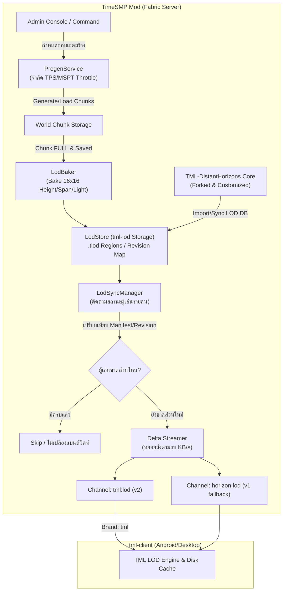

# แผน: ระบบสร้างล่วงหน้า (Pregen) + LOD Cache + ส่งข้อมูล LOD ให้ tml-client (ฝั่ง Mod / Server)

> สถานะ: **แผนอย่างเป็นทางการ (สรุปทิศทางตามมติเรียบร้อย)**
> ขอบเขต: ม็อด Fabric `timesmp` (MC 26.2 / 26.3, Java 25) ใน `/home/timeandtime/Mod/repo`
> คู่กับแผนฝั่งไคลเอนต์: [PLAN_TML_CLIENT_LOD_DH.md](PLAN_TML_CLIENT_LOD_DH.md)

---

## 1. ข้อสรุปทิศทางการออกแบบ (Design Decisions)

1. **ขอบเขตการสร้าง (Server Controlled):**
   - **เซิร์ฟเวอร์เป็นผู้กำหนดขอบเขตและปริมาณการสร้างล่วงหน้าเอง 100%** ผ่านคำสั่งหรือคอนฟิก (เช่น กำหนดรัศมี `radius` หรือขอบเขตบล็อก)
   - ไม่พึ่งพาการเดินสำรวจของผู้เล่นเพื่อสร้าง LOD ระยะไกล แต่ละเครื่องผู้เล่นมีข้อมูลเดิมที่ตนเองเคยสำรวจอยู่แล้ว
   - **ส่งเฉพาะพื้นที่ที่เซิร์ฟเวอร์ Pregen / บันทึกไว้แล้วเท่านั้น** (`generateMissing=false`) เพื่อป้องกัน DoS และป้องกันปัญหา Seed Leak
2. **ระบบการส่งข้อมูลแบบเติมเต็มส่วนที่ขาด (Differential Delta Push):**
   - เมื่อเซิร์ฟเวอร์ทำการ Pregen ขยายพื้นที่เพิ่มในภายหลัง ระบบจะมีระบบตรวจสอบผู้เล่นรายคน:
   - ผู้เล่นคนไหนยังขาดส่วนไหน (เปรียบเทียบจาก Tile Revision และ Bitset Manifest) เซิร์ฟเวอร์จะทยอยส่ง (Push) เฉพาะส่วนที่ยังไม่มีหรือส่วนที่มีการอัปเดตใหม่ไปให้เครื่องนั้นๆ อัตโนมัติ
3. **การระบุตัวตน (Brand Identification):**
   - ใช้ Brand **`tml`** สำหรับระบุตัวตนทั้งไคลเอนต์และเซิร์ฟเวอร์
4. **ช่องทางการเชื่อมต่อ:**
   - **Protocol v2:** ใช้ช่องทางแยกใหม่เฉพาะตัวคือ **`tml:lod`** สำหรับโปรโตคอลประสิทธิภาพสูง (Named Palette, Revision Manifest, ZSTD Compression, Chunk Invalidation Push)
   - ยังคงรองรับ `horizon:lod` v1 เป็นตัวสำรอง/ตัวเชื่อมต่อพื้นฐาน
5. **Distant Horizons Integration:**
   - **โคลนและนำมาพัฒนาต่อยอด (Fork & Adapt):** นำ Distant Horizons มาปรับแต่งให้เป็นระบบเฉพาะสำหรับ ecosystem ของ **TML** (ทั้งการจัดเก็บข้อมูล, รูปแบบ SQLite / FullDataSource และเน็ตเวิร์กการซิงก์แบบ TML Protocol)

---

## 2. สถาปัตยกรรมระบบ (Architecture)



---

## 3. รายละเอียดแต่ละระบบ

### A. เซิร์ฟเวอร์กำหนดการสร้าง (Server Pregen & Quota)
- คำสั่ง:
  ```
  /tsmp pregen start <world> <radius> [square|circle] [<x> <z>]
  /tsmp pregen status <world>
  /tsmp pregen pause|resume|cancel <world>
  /tsmp pregen bake <world> [radius]
  ```
- ควบคุมปริมาณโดยเซิร์ฟเวอร์ ไม่ปล่อยให้ภาระตกที่ไคลเอนต์
- มีระบบจำกัดการทำงานอัตโนมัติ (Throttling) เมื่อ MSPT > 40ms เพื่อไม่ให้เซิร์ฟเวอร์แล็ก

### B. ระบบตรวจสอบประวัติและการเติมเต็มข้อมูลผู้เล่น (Per-Player Delta Sync)
- เซิร์ฟเวอร์เก็บ **World Revision ID** และ **Region Revision Map** (32×32 tiles ต่อ 1 region block)
- เมื่อผู้เล่นเชื่อมต่อเข้าเกมด้วย Brand `tml`:
  1. ไคลเอนต์ส่ง Hash / Revision ล่าสุดของแคชในเครื่องตนเอง
  2. เซิร์ฟเวอร์คำนวณส่วนต่าง (Diff) ทันที
  3. หากเซิร์ฟเวอร์มีการ Pregen เพิ่มเติมทีหลัง เซิร์ฟเวอร์จะมาร์กส่วนใหม่และจัดคิวส่ง (Push Queue) ให้ผู้เล่นคนนั้นตามลำดับ:
     - พื้นที่ใกล้ตัวก่อน (Near-to-Far)
     - ระดับความละเอียดหยาบก่อน (Low Stride -> High Stride)
     - ถูกควบคุมปริมาณไม่เกินโควตาอัปโหลด (เช่น 128 - 512 KB/s ต่อคน)

### C. โปรโตคอล v2: `tml:lod`
- ใช้ Identifier: `tml:lod`
- ใช้ Palette อิงชื่อบล็อกและชื่อไบโอม (`minecraft:stone`, `minecraft:plains`) ปลอดภัยจากการ Remap เลข ID ข้ามเวอร์ชัน 26.2 และ 26.3
- ข้อมูลถูกบีบอัดด้วย **Zstandard (zstd)** ช่วยประหยัดพื้นที่จัดเก็บบนมือถือและประหยัดเน็ตได้มากกว่า 70%
- รองรับการแจ้งบล็อกเปลี่ยนแปลง (`InvalidatePacket`) เมื่อมีการสร้างบ้านหรือระเบิดพื้นที่

### D. Distant Horizons TML Fork
- โคลน Repository ของ Distant Horizons (`distant-horizons`) มาปรับโครงสร้างภายใน
- ปรับแต่ง Layer การส่งข้อมูลและ Engine ให้เข้ากับมาตรฐาน TML Client
- เชื่อมต่อการอ่าน/เขียนไฟล์ฐานข้อมูล `.sqlite` เข้ากับชุดข้อมูลของ `LodStore` ทำให้สามารถแชร์ข้อมูลระยะไกลร่วมกันได้อย่างราบรื่น

---

## 4. สรุปสถานะ
- [x] วางแผนระบบ Server Pregen ที่ควบคุมรัศมีได้เอง
- [x] ออกแบบระบบ Delta Sync ส่งเฉพาะส่วนที่ผู้เล่นยังขาดเมื่อมีการเจนโลกเพิ่ม
- [x] กำหนด Channel หลักเป็น `tml:lod` และ Brand เป็น `tml`
- [x] กำหนดแนวทางโคลน Distant Horizons มาทำต่อในแบบ TML
- [ ] รออนุมัติก่อนเริ่มพัฒนาโค้ด (ตามคำสั่ง: "อย่าเพิ่งทำ")
